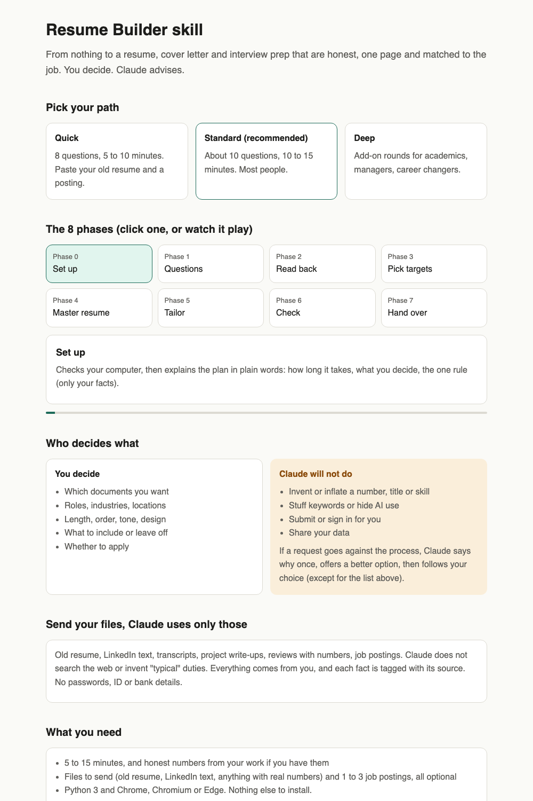
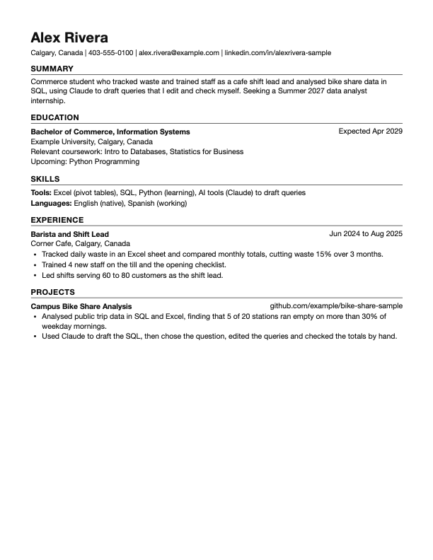

# Resume Builder skill for Claude

Get a finished, honest, one-page resume (and a cover letter and interview prep sheet if you want them) by answering a few questions. **You choose how much effort to put in.**



| Sample resume it builds |
|---|
|  |

## Pick your path

| Path | Questions | Time | Best if |
|---|---|---|---|
| **Quick** | 8 | 5 to 10 min | You are in a hurry or can paste your old resume |
| **Standard** (recommended) | about 10 | 10 to 15 min | Most people |
| **Deep** | 11 plus add-ons | 30+ min | Academics, managers, career changers, long histories |

Claude will offer these at the start. The biggest shortcut: **send your files** (see below) and Claude only asks for what is missing.

## Quick start

1. Install (below).
2. Open Claude and say: `Use the resume-builder skill. Start with the setup check.`
3. Pick a path, answer in your own words, and say "skip" or "change that" any time.

You always apply yourself. Claude never submits anything, and it will not invent facts.

## Send your files (Claude uses only what you give it)

Everything on your resume comes from **your answers, your files, and postings you paste**. Claude does not search the web, add "typical" duties for a job, or use its own ideas as facts. If something is missing, it asks you. That means you can explain every line in an interview.

**Good files to send:** old resume or CV, LinkedIn text, transcripts and certificates (with dates), project write-ups or READMEs, performance reviews or reports that show real numbers, job postings, and any company text you copied for a cover letter.

**Do not send:** passwords, ID or passport numbers, social insurance or security numbers, bank details, your full home address or health information. Remove them first.

Claude keeps copies in a `sources/` folder on your computer, tags each fact with where it came from, and asks you before using anything it only inferred. If you do want it to look something up, say so; it will label that as "researched", with the link and date, for you to verify.

## What you get

- A one-page, plain-text, ATS-friendly resume PDF built only from what you told Claude.
- Optionally: a tailored copy per job posting, a cover letter (5 short parts, under 250 words) and an interview prep sheet.
- A short "needs your input" list per job: eligibility questions, missing numbers, gaps, deadlines.
- A checker that confirms one page, no buzzwords or em dashes, every number is in your fact sheet, and nothing you rejected has crept back in.

## How it works

1. **Setup:** checks Python and Chrome, explains what happens, you pick a path.
2. **Questions:** short rounds, 3 to 5 at a time. Claude asks for a real number behind each result and never guesses.
3. **Read-back:** you see your fact sheet and fix anything wrong before anything is written.
4. **Targets:** Claude groups your goals into 1 to 3 types of job and checks each posting is still open.
5. **Documents:** a master resume, then tailored versions for each posting.
6. **Checks and handover:** PDFs, the gaps list, and a reminder that you review every line and send it yourself.

**You decide** length, order, tone and what to include. If a choice works against the process, Claude says why once, offers a better option, then follows you. It will not write false facts, claim skills you cannot back up, stuff keywords or hide your AI use (see `resume-builder/references/pushback.md`).

See it visually: open `docs/index.html`.

## Install

**Claude Code (terminal or desktop app):** copy the `resume-builder` folder into your skills folder.

```bash
mkdir -p ~/.claude/skills
cp -r resume-builder ~/.claude/skills/
```

**Claude.ai:** zip the `resume-builder` folder (the folder itself at the top of the zip) and upload it under Settings, Capabilities, Skills.

Needs: Python 3 and Google Chrome, Chromium or Edge (to print the PDF). Nothing else to install.

## What is in the repo

```
resume-builder/
  SKILL.md                  the workflow Claude follows
  references/
    paths.md                Quick, Standard or Deep
    question-bank.md        the core 11 questions plus add-ons
    sources-and-files.md    sending files, and why Claude uses only what you give it
    writing-rules.md        bullets, summary, skills, banned words, ATS
    format.md               the simple markdown resume format
    targeting.md            turning goals into job types and checking fit
    tailoring.md            matching a posting honestly
    cover-letter.md         the 5-part cover letter
    prep-sheet.md           interview prep sheet
    pushback.md             what Claude does when a request goes against the process
    special-cases.md        students, changers, gaps, academics, managers, non-English
    ai-disclosure.md        how to say where AI helped
  assets/                   fact sheet, resume and cover letter templates
  scripts/
    check_setup.py          checks your computer can run it
    build_resume.py         resume or letter .md to PDF (headless Chrome, no packages)
    check_resume.py         rule checks, rejected-claim check, keyword coverage
examples/                   a fictional sample fact sheet, resume and cover letter
docs/index.html             visual walkthrough
```

## Run the scripts yourself

```bash
python3 resume-builder/scripts/build_resume.py my-applications/resume.md my-applications/First_Last_Resume.pdf
python3 resume-builder/scripts/check_resume.py my-applications/resume.md \
  --profile my-applications/profile.md --pdf my-applications/First_Last_Resume.pdf
```

Try the fictional sample first: `examples/sample-resume.md`. Options: `--paper A4`, `--lang es`, `--max-pages 2`.

## Tested

Run end to end on six fictional people in two rounds (a student, a career changer, a newcomer, a senior nurse, a PhD moving to industry, and an applicant in Mexico with a Spanish resume), each trying to get Claude to inflate or hide something. Those runs found and fixed checker bugs and missing guidance, and every hard rule held. A third round tested the shorter Quick and Standard paths with a lazy and an impatient user; the Standard path was cut from 20 to about 10 questions because of it.

## Privacy

Your fact sheet and resumes stay in the folder you choose on your own computer. Do not commit them to a public repo. The `.gitignore` ignores `my-resume/` and `profile.md`.

## Limits

- Claude advises but you choose. It will not write false facts, and it says why.
- Built for one-page resumes in the North American style. Other formats are described in `special-cases.md` but not templated. The builder cannot place a photo.
- Fewer questions means less detail: Quick gives a solid but plainer resume. It does not guarantee interviews.
- Check every claim before you send. You are the one who has to explain it.

## Pair it with the tracker

Use [coop-job-tracker](https://github.com/BenShadabi/coop-job-tracker) to see the newest postings, track what you applied to and follow up. When you pick a posting there, bring its text here and Claude builds the tailored resume and cover letter. See more of my work at [github.com/BenShadabi](https://github.com/BenShadabi).

## Contributing

Issues and pull requests are welcome, especially other countries' resume norms and special cases. Keep the rule that the skill never invents facts.

## License

MIT. See `LICENSE`.
